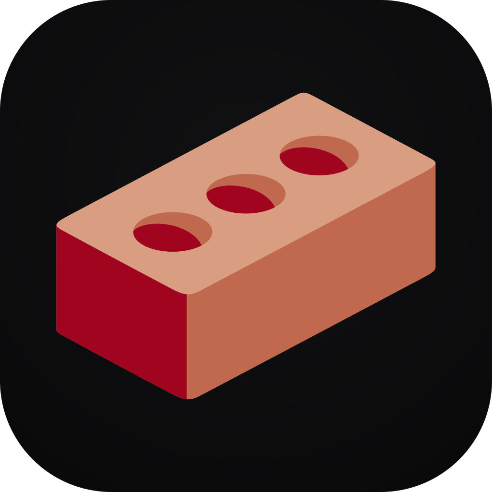
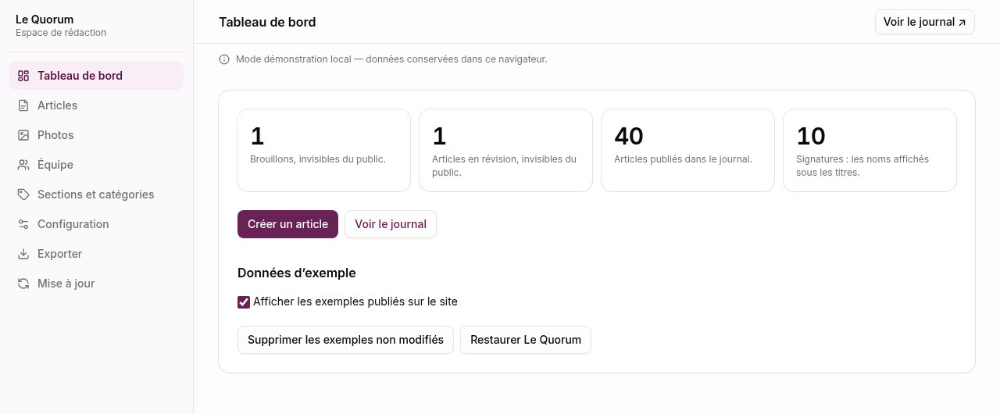
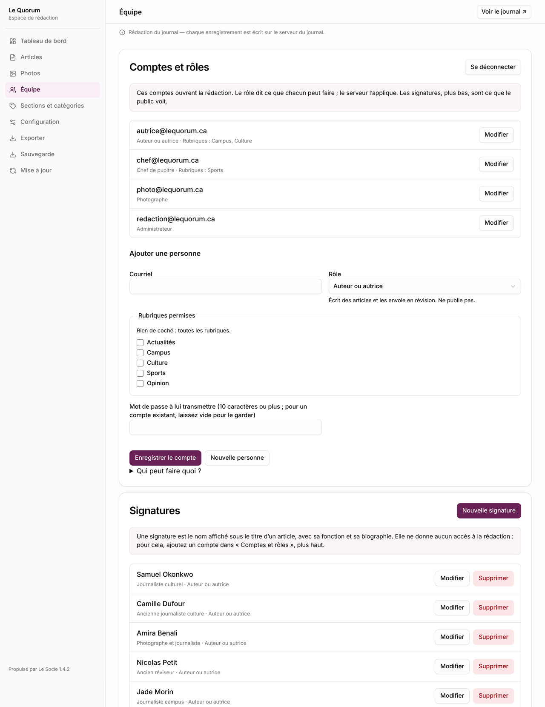
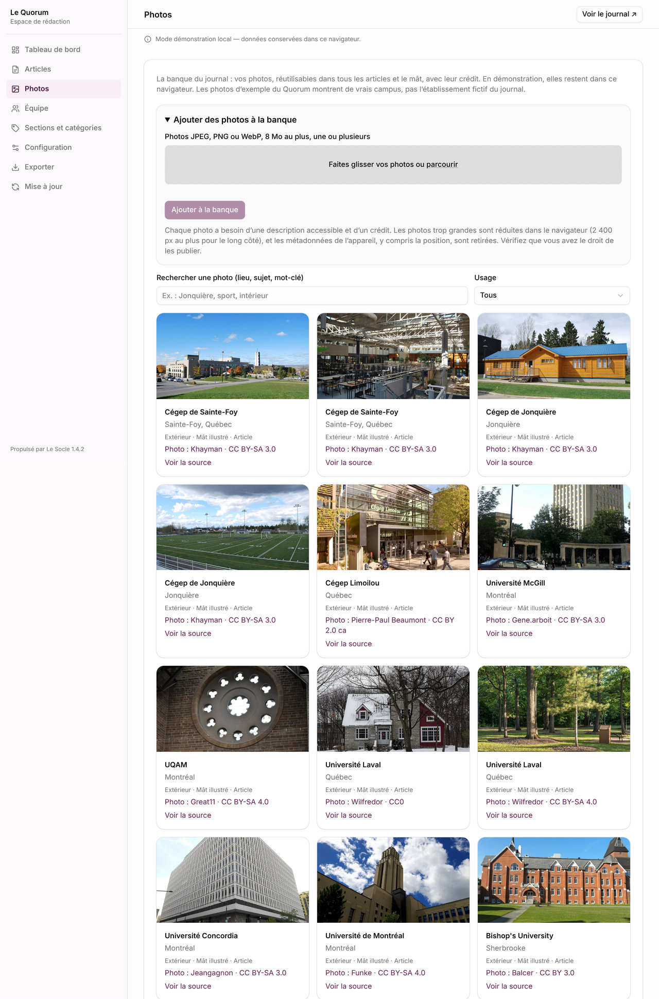

<picture>
  <source media="(prefers-color-scheme: dark)" srcset="site/assets/logo/icone-sombre.svg">
  
</picture>

# Le Socle

*Système Ouvert de Collaboration en Ligne pour l’Édition.*

**Espace de rédaction des journaux étudiants.** C’est l’interface d’administration et son serveur : on y écrit les articles, on gère les photos, les rôles, les sauvegardes et les mises à jour.

Le Socle n’est pas un service central. Chaque journal installe sa propre copie, chez lui, et reçoit les versions publiées à appliquer. Dans le cas le plus simple, le Socle arrive déjà dans le paquet complet du [Kiosque](https://azdak919.github.io/le-kiosque/), `kiosque-journal.zip`. Ce dépôt est le programme lui-même.

[](https://azdak919.github.io/le-socle/)

<p align="center"><em>Le tableau de bord, sur Le Quorum, journal de démonstration.</em></p>

- **Page de présentation :** <https://azdak919.github.io/le-socle/>
- **La plateforme dont il fait partie :** <https://azdak919.github.io/le-kiosque/>

---

## À qui ça s’adresse

Aux équipes qui utilisent le Kiosque, et à qui veut faire tourner l’espace de rédaction sur sa machine : hébergeur PHP, ou Node pour le développement et les tests. Un journal sous le Kiosque ne dépend jamais du serveur d’un autre projet.

---

## Ce qu’on y trouve

- **Rôles :** auteur, photographe, réviseur, chef de pupitre, éditeur, administrateur. Un auteur ou un chef de pupitre peut être limité à certaines rubriques ; hors de celles-ci, le serveur refuse même un brouillon.
- **Banque de photos :** ajout, fiche, crédit obligatoire, licence, retrait. Le photographe gère la banque et n’écrit pas d’articles.
- **Rédaction :** titre, chapeau, texte, rubriques, signatures multiples, statut (brouillon, en révision, publié). On peut prévisualiser un article dans le thème, sans le publier.
- **Sauvegarde et restauration :** un fichier ZIP avec les articles, les photos, l’équipe (sans les mots de passe) et les réglages. La même page restaure une archive.
- **Mise à jour en un clic**, quand une version est publiée. Une sauvegarde juste avant reste la bonne habitude.



<p align="center"><em>Les comptes de l’équipe, avec restriction par rubrique.</em></p>



<p align="center"><em>La banque de photos.</em></p>

---

## Comment l’obtenir

**Chemin recommandé :** installer le [paquet complet du Kiosque](https://github.com/azdak919/le-kiosque/releases/latest/download/kiosque-journal.zip). L’assistant dans le navigateur installe le site public et l’espace de rédaction en même temps. Voir le [guide d’une page](https://azdak919.github.io/le-kiosque/guide/).

**Pour faire tourner le Socle seul** (PHP, ou Node pour essayer et tester), le guide court est [`docs/adoption.md`](docs/adoption.md). En PHP, le contrôleur est `php/public/index.php` et la base, `php/data/socle.sqlite`, reste hors de la racine Web. Il faut PHP 8.1 ou plus récent, avec SQLite.

```bash
git clone https://github.com/azdak919/le-socle.git
cd le-socle
npm ci
npm test
npm start
```

`npm start` écoute `127.0.0.1:8787` et lit `socle.config.json`. Le site public du journal doit rester lisible si ce serveur est arrêté : seule l’écriture s’interrompt alors.

Les modules (rédaction, photos, identité, relecture, audience, abonnements) s’allument seulement au besoin. Le détail est dans le guide d’adoption. Le plan d’architecture est dans [`docs/plan.md`](docs/plan.md).

Un journal peut ajouter ses propres outils par des **extensions** déposées dans `extensions/` : elles survivent aux mises à jour et une extension en erreur est mise de côté sans arrêter l’espace de rédaction. Le contrat est dans [`docs/extensions.md`](docs/extensions.md).

---

## Licence et crédits

Le logiciel est sous [GPL version 2 seulement](LICENSE). Les articles, les photos et les noms du journal appartiennent à l’équipe qui les publie. Les composants tiers sont listés dans [`THIRD_PARTY.md`](THIRD_PARTY.md). Le logo reprend l’emoji « brique » de [Twemoji](https://github.com/jdecked/twemoji) (© Twitter, Inc. et autres contributeurs), sous licence [CC BY 4.0](https://creativecommons.org/licenses/by/4.0/deed.fr).
